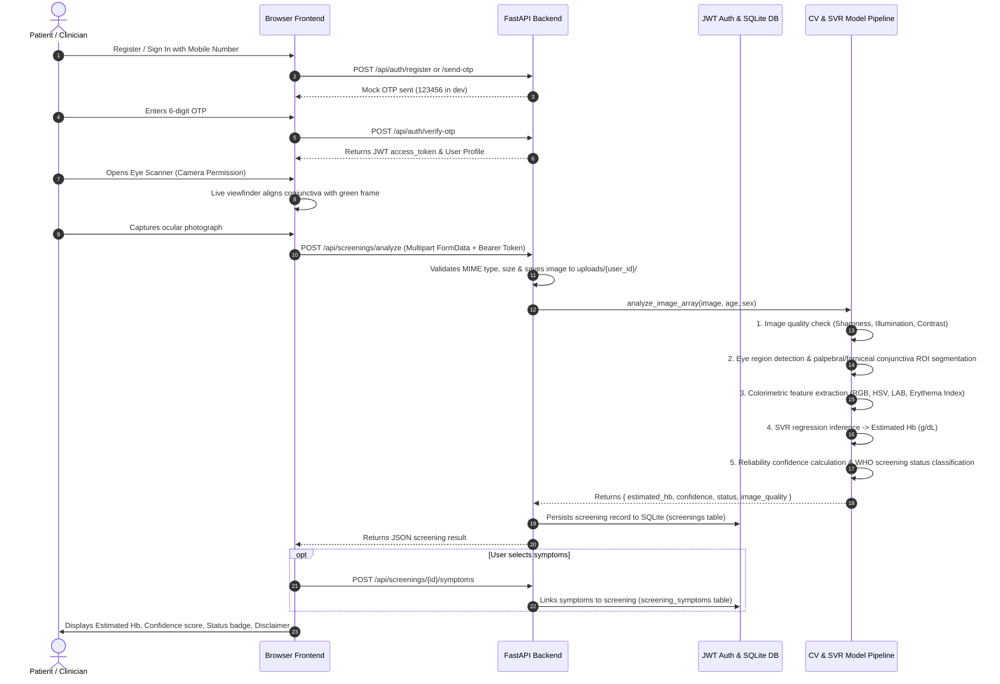

# Arogya Lens — System Architecture & Design

## 1. System Overview

**Arogya Lens** is an AI-powered non-invasive anaemia screening system designed to assess estimated Haemoglobin (Hb) levels from smartphone ocular conjunctiva photography.

```
+---------------------------------------------------------------------------------------+
|                                FRONTEND LAYER (Browser)                               |
|  - HTML5, Modern CSS / Tailwind, Vanilla JS / React 18 / TypeScript                   |
|  - Camera Access: navigator.mediaDevices.getUserMedia()                              |
|  - Real-time Eye Alignment Feedback (Visual guide & bounding frame)                  |
|  - Multi-tier Confidence Reporting & Interactive Zero-Dependency SVG Hb Trend Chart  |
+---------------------------------------------------------------------------------------+
                                        │  HTTP / JSON / Multipart
                                        ▼
+---------------------------------------------------------------------------------------+
|                                BACKEND API (FastAPI)                                  |
|  - RESTful API with OpenAPI /docs & /redoc                                            |
|  - Authentication: PyJWT Bearer Tokens (HS256)                                        |
|  - User Isolation: Cross-tenant data protection                                       |
|  - Request Validation: Pydantic 2.x schemas                                           |
|  - Database ORM: SQLAlchemy 2.x Declarative Base                                      |
+---------------------------------------------------------------------------------------+
                 │                                                   │
                 ▼                                                   ▼
+------------------------------------+             +------------------------------------+
|          DATABASE LAYER            |             |          AI / CV PIPELINE          |
|  - SQLite (arogya_lens.db)         |             |  - Image Quality Gate (Laplacian)  |
|  - 4 Relational Tables:            |             |  - Eye & Conjunctiva ROI Segmenter |
|    1. users                        |             |  - Color Features (RGB, HSV, LAB)  |
|    2. profiles                     |             |  - SVR Model (hb_model.joblib)     |
|    3. screenings                   |             |  - Optical Reliability Metric      |
|    4. screening_symptoms           |             |  - WHO Screening Status Classifier |
+------------------------------------+             +------------------------------------+
```

---

## 2. End-to-End User & Data Flow



---

## 3. Database Schema Design

```
+----------------------------------+       +----------------------------------+
|              users               |       |             profiles             |
+----------------------------------+       +----------------------------------+
| id: Integer (PK)                 |<----->| id: Integer (PK)                 |
| mobile_number: String(15) (UQ)   |       | user_id: Integer (FK -> users.id)|
| is_mobile_verified: Boolean      |       | name: String(100)                |
| is_active: Boolean               |       | age: Integer                     |
| created_at: DateTime             |       | sex: Enum(male, female, other)   |
| updated_at: DateTime             |       | created_at: DateTime             |
+----------------------------------+       | updated_at: DateTime             |
                 │                         +----------------------------------+
                 │ 1:N
                 ▼
+----------------------------------+       +----------------------------------+
|            screenings            |       |        screening_symptoms        |
+----------------------------------+       +----------------------------------+
| id: Integer (PK)                 | 1:N   | id: Integer (PK)                 |
| user_id: Integer (FK -> users.id)|<----->| screening_id: Integer (FK)       |
| checkup_date: Date               |       | symptom_name: String(50)         |
| checkup_time: Time               |       | custom_symptom: String(255)      |
| estimated_hb: Float              |       | created_at: DateTime             |
| confidence: Float                |       +----------------------------------+
| status: String(50)               |
| image_path: String(255)          |
| image_quality: String(50)        |
| created_at: DateTime             |
+----------------------------------+
```

---

## 4. Medical Terminology & Disclaimer Rules

1. **Screening Support Only**: Arogya Lens provides preliminary non-invasive optical estimation. It is not an automated clinical diagnosis or replacement for Complete Blood Count (CBC) venous testing.
2. **Standard Terminology**:
   - Estimated Hb (g/dL)
   - Confidence score (%)
   - Screening status (`likely_normal`, `possible_anemia`, `high_risk`)
3. **Mandatory Disclaimer**: Displayed on all screening and detail views:
   > *"Screening estimate — not a laboratory diagnosis. For diagnostic evaluation, consult a qualified healthcare professional."*
